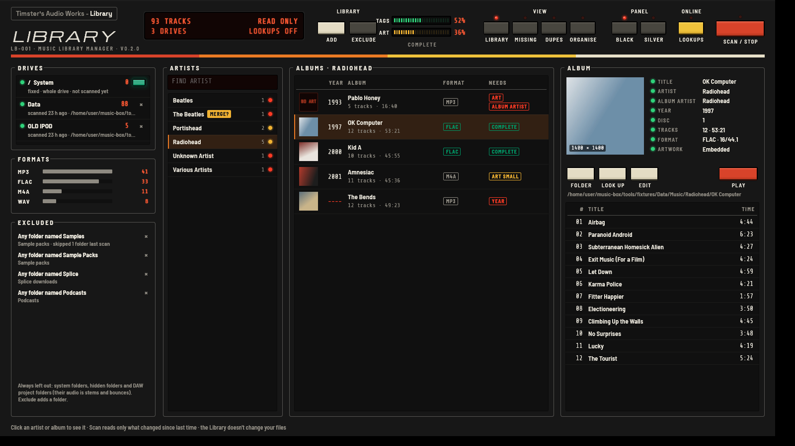

# TAW Library

**Timster's Audio Works – Library (LB-001) v0.2.0**: a native music library manager for Windows and Linux. One of the family's hi-fi separates, with the Player, Equaliser and Analyser, all on the same panel. It was called Music Box until 0.2.0.



It's a desktop program written in Rust (egui for the panel). It isn't an HTML page in a browser.

**The Library only reads your music.** It never changes, moves or deletes a file. Changing things comes in later stages, and always as a plan you review first.

## What it does now (stage 1)

- **Finds your drives**: internal, USB and network drives, on Windows and Linux. Each drive is recognised by its volume ID, not its drive letter, so E: becoming F: doesn't matter. A drive that's unplugged stays in the library, marked offline. When a drive is plugged in, Music Box notices within a few seconds.
- **Scans them** for MP3, FLAC, WAV, M4A (AAC and ALAC), AIFF, OGG, Opus, APE and WavPack. Each drive is scanned whole by default; switch a drive's green key off to scan only folders you add. A rescan only reads files that are new or changed (by size and date), so it's quick.
- **Leaves out what isn't your library**: system folders, hidden folders and DAW project folders (Ableton, FL Studio, Pro Tools, Cubase, Reaper, Logic, Studio One, Bitwig and others) always; folders named Samples, Sample Packs, Splice or Podcasts by default; and any folder you add with **Exclude**.
- **Library view**: artists, their albums by year with what each is missing, and an album's details, artwork and tracks. Albums split into CD1/CD2 folders are put back together.
- **What's Missing view**: albums with no artwork, artwork under 500 px, no year, no album artist, no track numbers, repeated track numbers with no disc numbers, and files with no tags at all. Click one to go to it.
- **Merge suggestions**: "Beatles" and "The Beatles" are flagged as probably the same artist.
- **Play** sends an album to your default music player as a playlist (until the TAW Player can take it).
- **Black or Silver panel**, remembered with the rest of your view.

## Coming next

See [ROADMAP.md](ROADMAP.md): online lookups (stage 2), tag editing with undo (stage 3), duplicates and the organise plan (stage 4).

## Where things are kept

- The library database: `%APPDATA%\Timster's Audio Works\Library\library.db` on Windows, `~/.local/share/timsters-audio-works/library/library.db` on Linux. Set `TAW_LIBRARY_DB` to use another file. A library from Music Box 0.1 is moved here the first time the Library starts.
- Panel settings: eframe's usual place for an app called "taw-library".

Deleting the database only makes the Library forget; your music isn't touched.

## Building

```sh
cargo build --release
```

On Linux you need the usual desktop libraries (X11 or Wayland, and libxkbcommon). The Windows build needs nothing extra.

### Trying it without your own music

`tools/make-test-library.sh` (needs ffmpeg) builds a deliberately messy test library of silent files in `tools/fixtures/`. Scan it into a separate database and open the panel on it:

```sh
tools/make-test-library.sh
cargo run --release -p mb-core --example scan -- /tmp/test.db tools/fixtures/Data "tools/fixtures/OLD IPOD"
TAW_LIBRARY_DB=/tmp/test.db cargo run --release
```
